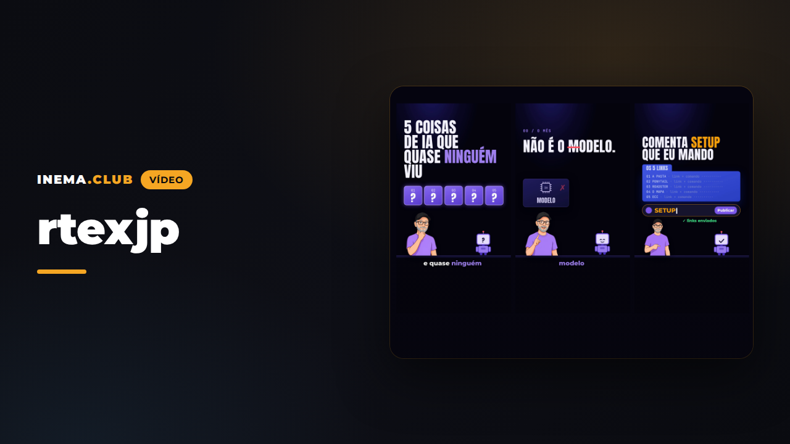

# rtexjp — motor de reels ilustrados 9:16

[](https://inematds.github.io/rtexjp/guia/es/)

**🇧🇷 [Português](README.md) · 🇺🇸 [English](README.en.md) · 🇪🇸 [Español](README.es.md)**

## Qué es

rtexjp es un motor que monta videos cortos verticales (reels) ilustrados, en tonos morados, a partir de un guion escrito en un archivo de texto (`roteiro.json`). Es el motor que Nei usa en los reels de INEMA, abierto para quien quiera estudiarlo o adaptarlo: sin grabarse a sí mismo y sin pagar por un servicio de avatar. Genera la voz, dibuja cada escena cuadro a cuadro, mezcla la banda sonora y comprueba por sí solo que el video siga el formato. Necesita una computadora con tarjeta gráfica (GPU), Python, Node, ffmpeg y dos servidores locales: el de voz ([inemavox](https://github.com/inematds/inemavox)) y el de imágenes ([inemaimg](https://github.com/inematds/inemaimg), flux2-klein).

Viene configurado con la voz y el avatar de Nei. Para usar los tuyos, cambia la grabación de referencia de la voz (`VOZ_REF` en `rtexjp.py`) y la foto del avatar (`REF` en `motor/gerar_avatar.py`) y vuelve a generar las poses; esos dos archivos no vienen en el repositorio.

## 📖 Guía de uso

Guía completa (landing + paso a paso): **https://inematds.github.io/rtexjp/guia/es/** · video de ejemplo: https://www.youtube.com/watch?v=AZEZK1YgF98

**v1.0.0** · motor local y gratis que transforma un `roteiro.json` en un reel vertical 1080×1920 con el **estándar rtexjp**: un reel ilustrado, fondo casi negro con un haz de luz morada, avatar ilustrado de Nei (sin lip-sync, en poses), mascota robot, subtítulo titular de 2–3 palabras y un único CTA «comenta PALABRA».

## El formato (estándar rtexjp)

Estructura fija, comprobada por el validador:

1. **Tesis escrita en el cuadro 0** — en mayúsculas, una palabra en lila; sirve de portada (quien desliza sin sonido lee la tesis).
2. **Prueba social con un número en pantalla** — contador que se posa sobre el número, línea de fuente en monoespaciada debajo.
3. **La palabra gancho es la tesis y se introduce temprano** (aquí: SETUP, ~65 s antes de la petición), siempre en el único color cálido del video.
4. **«N piezas» anunciadas con índice visible** (carpeta 01…05) y barra de cápsulas 01–05 en la parte superior durante las piezas.
5. **Una pieza a la vez, un objeto visual por frase** — el objeto cambia dentro de la escena cada ~2–3 s (robots, cable que se rompe, carpeta, tarjeta de repositorio, sello, mapa que se dibuja, terminal).
6. **Prueba con la fuente en pantalla** — todos los números incluyen `fonte: …` por escrito.
7. **Salvedad honesta hablada**, en una tarjeta de alerta (rojo = problema, verde = correcto).
8. **Máxima en antítesis**, después de **0,8 s de silencio real** (la voz y la cama musical se detienen).
9. **CTA «comenta PALABRA»** con el cuadro de comentario escribiendo la palabra → Publicar → confirmación; tarjeta en pantalla durante ~9–10 s, sin despedida, último tramo sin subtítulos.

Visual: fondo `#05040f`, morado `#6b51d2`/`#7e58eb`, lila `#a080ef`/`#9974f8`, blanco; naranja `#f59f0c` **solo** en la palabra gancho; verde/rojo solo para correcto/incorrecto. Títulos en Anton (condensada en mayúsculas), rótulos y fuentes en JetBrains Mono, subtítulo en Montserrat ExtraBold a ~77 % de la altura. Zonas seguras de Reels: nada importante debajo del 80 % de la altura ni en la franja derecha de los iconos (excepto la terminal cortada a propósito en el borde: el entregable queda detrás del comentario).

Audio: voz de Nei (inemavox chatterbox, 0,6/0,6, `atempo` ≤ 1,15, pausas internas acortadas), 160–190 palabras/min, cama musical baja con sidechain, master −14 LUFS.

> **Excepción al kit INEMA:** la paleta morada/lila, el avatar ilustrado y la mascota son decisiones de proyecto (registradas en `inema-design/DECISOES.md`). El resto del kit se mantiene.

## Estructura

```
rtexjp.py              pipeline: checar · voz · cena · render · mix · qa · tudo
medir.py               QA automático (duración, wpm, LUFS, cambios/min, gancho, tarjeta final, silencio, grep de fuente) + contact.jpg
motor/palco.html       el escenario: componentes de escena dibujados por window.render(t) (determinista)
motor/render.mjs       Playwright cuadro a cuadro -> ffmpeg (30 fps)
motor/gerar_avatar.py  poses del avatar en flux2-klein local con la foto de referencia (fondo verde recortado)
motor/gerar_imagem.py  imagen de escena en flux2-klein local
motor/whisper.py       Whisper large-v3 local (inemavox) con tiempo por palabra
motor/avatar/*.png     poses: brazos, barbilla, señalando, sosteniendo, sorprendido, mostrando
motor/assets/          trilha.mp3 (cama), carro.png
edicoes/<id>/          roteiro.json · final.mp4 · contact.jpg · qa.md (voz/ y build/ quedan fuera de git)
```

## El proceso, de principio a fin

🧠 sesión con Nei · ⚙️ script (cero tokens) · 🤖 `claude -p` / Codex con suscripción (nunca API)

| # | Paso | Comando | Quién |
|---|---|---|---|
| 1 | Tema: tesis, 2–5 piezas, números comprobados (✅ con fuente y fecha) | — | 🧠 |
| 2 | Guion: escribir `edicoes/<id>/roteiro.json` (texto hablado en su totalidad, `fala_tts` para la pronunciación, disparadores por palabra, gancho = tesis) | editar el JSON (o 🤖 a partir del tema) | 🤖 + 🧠 |
| 3 | Validar las reglas del formato | `python3 rtexjp.py checar edicoes/<id>` | ⚙️ |
| 4 | Aprobar el guion (gancho, entregable, números) | — | 🧠 |
| 5 | Poses del avatar (una vez; volver a generarlas solo si cambia el personaje) | `python3 motor/gerar_avatar.py` | ⚙️ |
| 6 | Imágenes de escena, si la pieza lo requiere | `python3 motor/gerar_imagem.py motor/assets/x.png "<prompt>"` | ⚙️ |
| 7 | Voz por bloque + Whisper (tiempo por palabra) | `python3 rtexjp.py voz edicoes/<id> [bloco …]` (con nombres, solo vuelve a generar esos TTS) | ⚙️ |
| 8 | Escena (guion + tiempos) | `python3 rtexjp.py cena edicoes/<id>` | ⚙️ |
| 9 | Vista previa de cuadros | `node motor/render.mjs edicoes/<id>/build --quadros 0,10,20` → `edicoes/<id>/quadros/` | ⚙️ |
| 10 | Render 1080×1920 30 fps | `python3 rtexjp.py render edicoes/<id>` | ⚙️ |
| 11 | Mezcla (la cama se detiene durante el silencio de la máxima, −14 LUFS) | `python3 rtexjp.py mix edicoes/<id>` | ⚙️ |
| 12 | QA automático + hoja de contacto | `python3 rtexjp.py qa edicoes/<id>` → `qa.md`, `contact.jpg` | ⚙️ |
| 13 | Revisar `contact.jpg` y el video; revisor independiente si se va a publicar | — | 🧠 / 🤖 |
| 14 | **Entregable del CTA disponible** (página en inema.club con lo que promete el CTA) | — | orquestador |
| 15 | Publicar (cola del canal / v3 / Telegram) | fuera de este repositorio | orquestador |

Atajo: `python3 rtexjp.py tudo edicoes/<id>` ejecuta 3 → 7 → 8 → 10 → 11 → 12.

## Requisitos

- `~/projetos/inemavox` (TTS chatterbox en `venv`, Whisper large-v3), voz `~/projetos/timesmkt3/media/voice-refs/nei.wav`
- servidor de imágenes local `http://localhost:8000` (flux2-klein), foto `~/projetos/inema-referencias/nei-avatar.jpg`
- Node + `npm i` (Playwright 1.64), ffmpeg, Python 3 con Pillow y numpy

## Edición 2026-10-28 — «5 cosas de IA de este mes que casi nadie notó»

`edicoes/2026-10-28-5-coisas/final.mp4` — 5 piezas (una carpeta por tarea, ponytail, Roadster, Understand Anything, ECC), gancho **SETUP**.

> ⚠️ **Antes de publicar:** el CTA promete «los cinco enlaces y los comandos». Ese paquete **debe existir** en inema.club/guia (página con los 5 enlaces y los comandos de instalación) antes de que el video salga al aire. Responsable: orquestador.